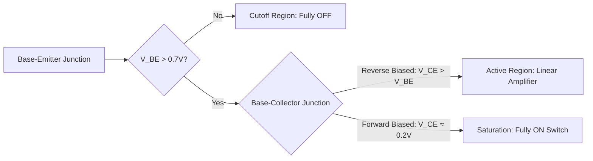
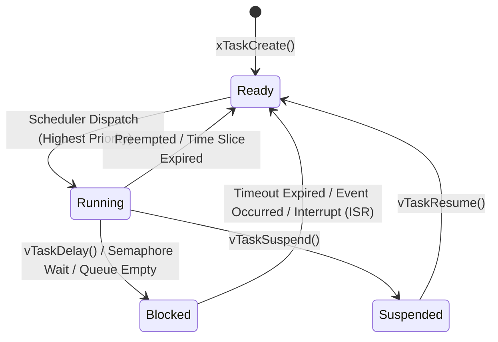
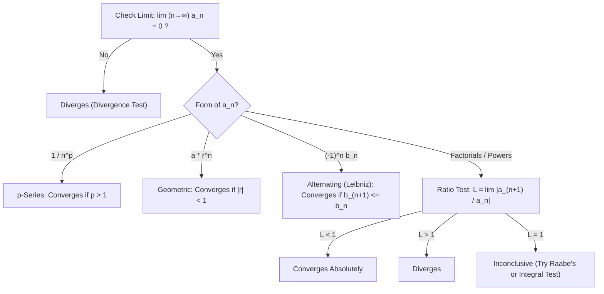

# ⚡ Systems & Hardware Engineering Cheatsheet

[](https://awesome.re)
[](http://creativecommons.org/publicdomain/zero/1.0/)
[](http://makeapullrequest.com)
[](https://github.com/)

> A high-density, zero-fluff reference guide for Embedded Systems, Analog/Digital Electronics, Engineering Math, and Linux System Administration. Built with native GitHub LaTeX and Mermaid diagrams.

---

## 🧭 Table of Contents
1. [Analog Electronics & Op-Amps](#-1-analog-electronics--op-amps)
2. [Embedded Systems & Microcontrollers](#-2-embedded-systems--microcontrollers)
3. [Engineering Mathematics](#-3-engineering-mathematics)
4. [Linux CLI & Systems Debugging](#-4-linux-cli--systems-debugging)
5. [SQL & Time-Series Data](#-5-sql--time-series-data)
6. [Bonus: Bytebeat & Algorithmic Audio](#-6-bonus-bytebeat--algorithmic-audio)

---

## 🔌 1. Analog Electronics & Op-Amps

### Passive RC / RL Filters
* **Capacitive Reactance:** $X_C = \frac{1}{2\pi f C}$
* **Inductive Reactance:** $X_L = 2\pi f L$
* **Cutoff Frequency ($-3\text{ dB}$ point):**

$$f_c = \frac{1}{2\pi R C} = \frac{R}{2\pi L}$$

* **Time Constant ($\tau$):** $\tau = R \cdot C$ (Reaches $\approx 63.2\%$ of final value in $1\tau$, and $\approx 99.3\%$ in $5\tau$).

### Operational Amplifiers (Ideal Model: $Z_{in} = \infty$, $Z_{out} = 0$, $A_{OL} = \infty$)

| Configuration | Transfer Function | Input Impedance ($Z_{in}$) | Key Application |
| :--- | :--- | :--- | :--- |
| **Voltage Follower** | $V_{out} = V_{in}$ | $\infty$ (Ideal) | Buffering high-impedance sensors |
| **Inverting** | $V_{out} = -V_{in} \left(\frac{R_f}{R_{in}}\right)$ | $R_{in}$ | Phase inversion, current-to-voltage |
| **Non-Inverting** | $V_{out} = V_{in} \left(1 + \frac{R_f}{R_g}\right)$ | $\infty$ (Ideal) | High-impedance signal amplification |
| **Differential** | $V_{out} = \frac{R_f}{R_{in}}(V_2 - V_1)$ | $R_{in}$ | Shunt current sensing, noise rejection |
| **Integrator** | $V_{out}(t) = -\frac{1}{RC} \int_0^t V_{in}(\tau) d\tau$ | $R$ | Wave shaping (Square $\to$ Triangle), PID |

### BJT Transistor Regions (NPN)

* **Collector Current (Active):** $I_C = \beta I_B = I_S \left( e^{\frac{V_{BE}}{V_T}} - 1 \right)$, where thermal voltage $V_T = \frac{kT}{q} \approx 25.85\text{ mV}$ at $300\text{ K}$.

---

## 🎛️ 2. Embedded Systems & Microcontrollers

### Bitwise Manipulation Macros (C / C++)
Essential register operations without touching adjacent bits:

```c
#define BIT_SET(REG, BIT)     ((REG) |= (1ULL << (BIT)))
#define BIT_CLEAR(REG, BIT)   ((REG) &= ~(1ULL << (BIT)))
#define BIT_TOGGLE(REG, BIT)  ((REG) ^= (1ULL << (BIT)))
#define BIT_READ(REG, BIT)    (((REG) >> (BIT)) & 1ULL)
```

### Hardware Communication Protocols
| Protocol | Wires | Duplex | Max Speed (Typical) | Topology | Pull-up Resistors? |
| :--- | :--- | :--- | :--- | :--- | :--- |
| **UART** | 2 (`TX`, `RX`) | Full | $\le 5\text{ Mbps}$ | Peer-to-Peer | No |
| **I2C** | 2 (`SDA`, `SCL`) | Half | $100\text{ kHz} - 3.4\text{ MHz}$ | Multi-Master / Multi-Slave | **Yes** ($2.2\text{ k}\Omega - 10\text{ k}\Omega$) |
| **SPI** | 4 (`MOSI`, `MISO`, `SCK`, `CS`) | Full | $10 - 100+\text{ MHz}$ | 1 Master / Multi-Slave | No |
| **CAN** | 2 (`CAN_H`, `CAN_L`) | Half | $1\text{ Mbps}$ (CAN 2.0) | Differential Bus | $120\,\Omega$ termination at ends |

### PWM & Servo Control Math (ESP32 / STM32)
Standard hobby servos (e.g., SG90, MG996R) expect a $50\text{ Hz}$ PWM signal ($T = 20\text{ ms}$ period):
* **$0^\circ$ (Min):** $1.0\text{ ms}$ pulse width ($5\%$ duty cycle) — *Note: many clones use $0.5\text{ ms}$*.
* **$90^\circ$ (Center):** $1.5\text{ ms}$ pulse width ($7.5\%$ duty cycle).
* **$180^\circ$ (Max):** $2.0\text{ ms}$ pulse width ($10\%$ duty cycle) — *Note: many clones use $2.5\text{ ms}$*.

**Timer Prescaler & Period Formula (STM32):**

$$f_{PWM} = \frac{f_{TIM\_CLK}}{(PSC + 1) \cdot (ARR + 1)}$$

### ADC Quantization & Resolution
For an $N$-bit ADC with reference voltage $V_{ref}$:

$$\text{LSB} = \frac{V_{ref}}{2^N - 1}, \quad V_{measured} = \text{ADC\_RAW} \times \frac{V_{ref}}{2^N - 1}$$

* **Signal-to-Noise Ratio (Ideal ADC):** $\text{SNR}_{\text{dB}} = 6.02 \cdot N + 1.76$

### RTOS Task State Machine


---

## 📐 3. Engineering Mathematics

### Infinite Series Convergence Tests
Given a series $\sum_{n=1}^{\infty} a_n$:



### Fourier & Laplace Transforms
* **Continuous Fourier Transform:**

$$F(\omega) = \int_{-\infty}^{\infty} f(t) e^{-j\omega t} \, dt$$

* **Unilateral Laplace Transform (Control Systems):**

$$F(s) = \mathcal{L}\{f(t)\} = \int_{0}^{\infty} f(t) e^{-st} \, dt, \quad s = \sigma + j\omega$$

<details>
<summary><b>Click to expand: Common Laplace Transform Pairs</b></summary>

| Time Domain $f(t)$ ($t \ge 0$) | Laplace Domain $F(s)$ | Region of Convergence |
| :--- | :--- | :--- |
| Dirac Delta $\delta(t)$ | $1$ | All $s$ |
| Unit Step $u(t)$ | $\frac{1}{s}$ | $\text{Re}(s) > 0$ |
| Ramp $t$ | $\frac{1}{s^2}$ | $\text{Re}(s) > 0$ |
| Exponential Decay $e^{-at}$ | $\frac{1}{s + a}$ | $\text{Re}(s) > -a$ |
| Sine Wave $\sin(\omega t)$ | $\frac{\omega}{s^2 + \omega^2}$ | $\text{Re}(s) > 0$ |
| Cosine Wave $\cos(\omega t)$ | $\frac{s}{s^2 + \omega^2}$ | $\text{Re}(s) > 0$ |
| Derivative $\frac{df(t)}{dt}$ | $sF(s) - f(0^-)$ | — |

</details>

---

## 🐧 4. Linux CLI & Systems Debugging (Fedora / RHEL / Debian)

### Hardware & Serial Debugging
```bash
# List all USB devices and bus tree
lsusb && lsusb -t

# Watch kernel ring buffer in real-time (catch USB/Serial plug events)
dmesg -wH

# Connect to UART serial port at 115200 baud (using picocom or minicom)
picocom -b 115200 /dev/ttyUSB0

# Grant current user access to serial ports without sudo (re-login required)
sudo usermod -aG dialout,uucp $USER

# Inspect ELF binary size (Flash vs RAM usage for embedded targets)
arm-none-eabi-size firmware.elf
```

### Systemd, Processes & Networking
```bash
# Find which process is holding a specific port (e.g., 8080)
sudo ss -tulpn | grep :8080

# Analyze boot performance and slow services
systemd-analyze blame

# Follow logs of a specific background service
journalctl -u nginx.service -f

# Check open files / serial locks by process
lsof /dev/ttyUSB0
```

### DNF Package Management (Fedora / RHEL)
```bash
# Find which package provides a missing library or binary
dnf provides "*/libGL.so.1"

# View transaction history and rollback a broken update
sudo dnf history
sudo dnf history undo <ID>
```

---

## 🗄️ 5. SQL & Time-Series Data

### Execution Order vs. Lexical Order
SQL queries are **not** executed in the order they are written:


### Analytical Window Functions (Sensor Telemetry Example)
Calculate a 5-point moving average and delta from the previous reading without collapsing rows:

```sql
SELECT 
    device_id,
    recorded_at,
    voltage_mv,
    LAG(voltage_mv, 1) OVER (PARTITION BY device_id ORDER BY recorded_at) AS prev_voltage,
    AVG(voltage_mv) OVER (
        PARTITION BY device_id 
        ORDER BY recorded_at 
        ROWS BETWEEN 4 PRECEDING AND CURRENT ROW
    ) AS moving_avg_5pt
FROM sensor_telemetry
WHERE recorded_at >= NOW() - INTERVAL '24 hours';
```

---

## 🎵 6. Bonus: Bytebeat & Algorithmic Audio

1-line C expressions evaluated at sample rate $f_s = 8000\text{ Hz}$, where `t` is a monotonically increasing integer (`uint32_t t = 0, 1, 2...`), outputting an 8-bit unsigned PCM waveform (`0..255`).

* **Frequency Conversion:** To generate a tone of frequency $f_{\text{Hz}}$ at sample rate $f_s$:

$$\text{Step per increment} = \frac{256 \cdot f_{\text{Hz}}}{f_s}$$

* **Classic 42 Melody:**
  ```c
  t * (42 & t >> 10)
  ```
* **Exponential Decay Kick / Bass Drum Envelope:**
  ```c
  (int)(sin(sqrt(t % 4096) * 20) * 127) + 128
  ```
* **Pseudo-Random Noise Hat (LFSR approximation):**
  ```c
  ((t * (t >> 8 | t >> 9) & 46 & t >> 8)) ^ (t & t >> 13 | t >> 6)
  ```

---

## 🤝 Contributing
Contributions, corrections, and new engineering formulas are welcome!
1. Fork the repository.
2. Ensure all math uses native `$inline$` or `$$block$$` LaTeX syntax (no external images).
3. Ensure all diagrams use native `mermaid` code blocks.
4. Submit a Pull Request.

## 📄 License
To the extent possible under law, the authors have waived all copyright and related or neighboring rights to this work under the **CC0 1.0 Universal Public Domain Dedication**.
