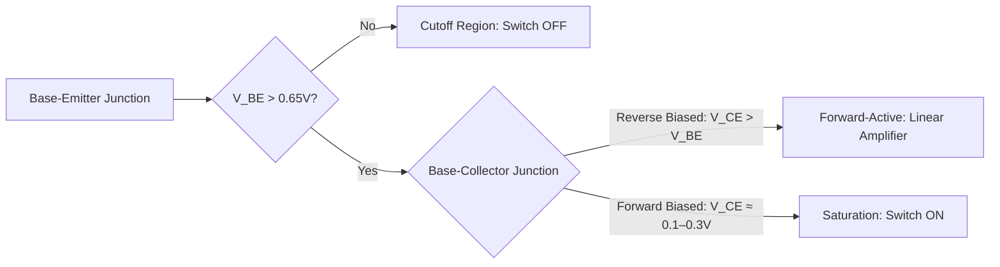
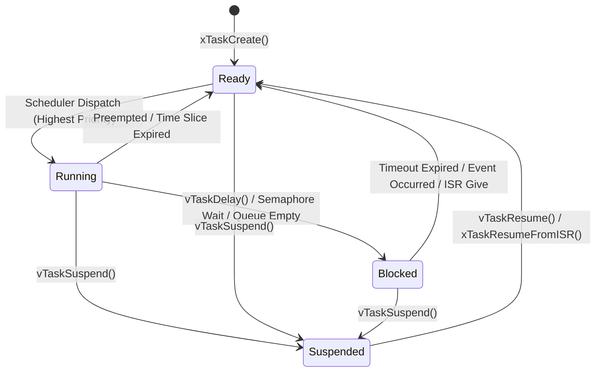
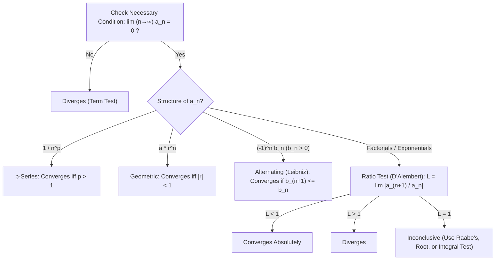

# ⚡ Embedded Engineering Handbook

[](https://github.com/X3lyz3/embedded-engineering-handbook/actions/workflows/deploy-docs.yml)
[](http://creativecommons.org/publicdomain/zero/1.0/)
[](./CONTRIBUTING.md)

> A practical, open-source engineering reference for embedded firmware developers, hardware engineers, and technical students. Covers analog signal conditioning, STM32 and ESP32 hardware design traps, engineering mathematics, Linux hardware debugging, and reproducible calculation tools—rendered natively with LaTeX and Mermaid diagrams.

🌐 **Live Searchable Documentation:** [x3lyz3.github.io/embedded-engineering-handbook](https://x3lyz3.github.io/embedded-engineering-handbook/)

---

## 🎯 Why This Handbook Exists

During schematic capture, firmware bring-up, or lab debugging, engineers repeatedly look up the same reference material across thousand-page datasheets and application notes: op-amp transfer functions, which ESP32 strapping pins trigger bootloops, why an STM32 timer runs at twice the expected APB clock, or which `picocom` and `udev` rules unlock a serial port.

This repository consolidates verified formulas, hardware checklists, runnable scripts, and SPICE netlists into a single version-controlled reference free of marketing fluff or blurry raster images.

---

## 📂 Repository Contents & Included Tools

* 📄 **`README.md`** — Core engineering reference tables, transfer functions, state machines, and hardware design checklists.
* 📌 **[`pinouts/esp32_family_comparison.md`](https://github.com/X3lyz3/embedded-engineering-handbook/blob/main/pinouts/esp32_family_comparison.md)** — Architecture, memory, radio, usable GPIO count, and native USB D+/D- pinout comparison across ESP32, S2, S3, C3, and C6.
* 🐍 **[`scripts/stm32_timer_calc.py`](https://github.com/X3lyz3/embedded-engineering-handbook/blob/main/scripts/stm32_timer_calc.py)** — Dependency-free Python CLI tool that calculates optimal integer `PSC` and `ARR` register pairs for 16-bit and 32-bit STM32 timers, including PWM duty-cycle resolution in bits.
* 📈 **[`simulations/sallen_key_lpf_1khz.cir`](https://github.com/X3lyz3/embedded-engineering-handbook/blob/main/simulations/sallen_key_lpf_1khz.cir)** — Standard SPICE-3f5 netlist for a 2nd-order Butterworth Sallen-Key low-pass filter ($f_c = 1\text{ kHz}$), compatible with ngspice, LTspice, and Micro-Cap.

### Quick Start: Running Included Tools Locally

```bash
# 1. Clone the repository
git clone [https://github.com/X3lyz3/embedded-engineering-handbook.git](https://github.com/X3lyz3/embedded-engineering-handbook.git)
cd embedded-engineering-handbook

# 2. Run the STM32 timer register solver (e.g., 72 MHz timer clock, 50 Hz PWM, 16-bit timer)
python3 scripts/stm32_timer_calc.py --clk 72000000 --freq 50 --bits 16

# 3. Run the Sallen-Key filter AC sweep in ngspice (batch mode)
ngspice -b simulations/sallen_key_lpf_1khz.cir
```

---

## 🧭 Table of Contents

1. [Analog Electronics & Op-Amps](#-1-analog-electronics--op-amps)
2. [Embedded Systems & Microcontrollers](#-2-embedded-systems--microcontrollers)
3. [MCU Boot Traps & PCB Design Checklist](#-3-mcu-boot-traps--pcb-design-checklist)
4. [Engineering Mathematics](#-4-engineering-mathematics)
5. [Linux CLI & Hardware Debugging](#-5-linux-cli--hardware-debugging)
6. [IoT Telemetry SQL Patterns](#-6-iot-telemetry-sql-patterns)
7. [Fixed-Point Audio Synthesis (Bytebeat)](#-7-fixed-point-audio-synthesis-bytebeat)

---

## 🔌 1. Analog Electronics & Op-Amps

### Passive First-Order RC / RL Filters

* **Capacitive Reactance:** $X_C = \frac{1}{2\pi f C}$
* **Inductive Reactance:** $X_L = 2\pi f L$
* **Cutoff Frequency (-3 dB half-power point, $|H(j\omega_c)| = \frac{1}{\sqrt{2}} \approx 0.7071$, phase shift $\phi = \pm 45^\circ$):**

$$
f_c = \frac{1}{2\pi R C} = \frac{R}{2\pi L}
$$

* **Step-Response Time Constant:** $\tau = R \cdot C$ or $\tau = \frac{L}{R}$. A charging RC network reaches **63.2%** ($1 - e^{-1}$) of its final step change in $1\tau$, **95.0%** in $3\tau$, and **99.3%** in $5\tau$.

### Operational Amplifiers (Ideal Model)

Ideal Op-Amp assumptions: infinite differential input impedance ($Z_{in} = \infty$), zero output impedance ($Z_{out} = 0$), infinite open-loop gain ($A_{OL} = \infty$), and infinite bandwidth. In practical designs, verify rail-to-rail input/output (RRIO) limits, input offset voltage ($V_{OS}$), and gain-bandwidth product ($\text{GBWP}$).

| Configuration | Closed-Loop Transfer Function | Effective Input Impedance | Primary Application |
| :--- | :--- | :--- | :--- |
| **Voltage Follower (Buffer)** | $V_{out} = V_{in}$ | $\infty$ (Ideal) | Impedance matching for high-$Z$ sensors & ADC inputs |
| **Inverting Amplifier** | $V_{out} = -V_{in} \left(\frac{R_f}{R_{in}}\right)$ | $R_{in}$ | Phase inversion, summing amplifiers |
| **Non-Inverting Amplifier** | $V_{out} = V_{in} \left(1 + \frac{R_f}{R_g}\right)$ | $\infty$ (Ideal) | High-impedance voltage amplification |
| **Differential Amplifier** | $V_{out} = \frac{R_f}{R_{in}}(V_2 - V_1)$ *(for matched ratios)* | $R_{in}$ (Inverting path) | Low-side/high-side shunt current sensing |
| **Inverting Integrator** | $V_{out}(t) = -\frac{1}{RC} \int_0^t V_{in}(\tau) \, d\tau + V_{out}(0)$ | $R$ | Wave shaping (Square to Triangle), analog PID loops |

> **Practical Integrator Warning:** Always place a large feedback resistor $R_f \gg R$ in parallel with capacitor $C$ in practical op-amp integrators; otherwise, input bias current and offset voltage ($V_{OS}$) will integrate over time and saturate the output to the supply rail.

### BJT Transistor Operating Regions (NPN Silicon)



* **Ebers-Moll Collector Current (Forward-Active):** $I_C = \beta I_B \approx I_S \left( e^{\frac{V_{BE}}{V_T}} - 1 \right)$
* **Thermal Voltage:** $V_T = \frac{kT}{q} \approx 25.85\text{ mV}$ at $T = 300\text{ K}$ ($26.85^\circ\text{C}$). Note that $V_{BE}$ decreases by approximately $-2\text{ mV}/^\circ\text{C}$.

---

## 🎛️ 2. Embedded Systems & Microcontrollers

### Bitwise Register Manipulation Macros (C99 / C11)

Safe register bit manipulation using unsigned `1ULL` shifts. When modifying hardware registers shared between main context and ISRs, ensure operations are atomic or protected by critical sections:

```c
#define BIT_SET(REG, BIT)     ((REG) |= (1ULL << (BIT)))
#define BIT_CLEAR(REG, BIT)   ((REG) &= ~(1ULL << (BIT)))
#define BIT_TOGGLE(REG, BIT)  ((REG) ^= (1ULL << (BIT)))
#define BIT_READ(REG, BIT)    (((REG) >> (BIT)) & 1ULL)
```

### Hardware Serial Communication Protocols

| Protocol | Signals | Duplex | Typical Speed | Bus Topology | External Pull-ups / Termination |
| :--- | :--- | :--- | :--- | :--- | :--- |
| **UART** | 2 (`TX`, `RX`) | Full | 9600 bps – 5 Mbps | Point-to-Point | None (idle HIGH push-pull) |
| **I2C** | 2 (`SDA`, `SCL`) | Half | 100 kHz (Std) / 400 kHz (Fast) / 1–3.4 MHz | Multi-Controller / Multi-Target | **Required** (2.2 kΩ – 10 kΩ to $V_{DD}$, open-drain) |
| **SPI** | 4 (`MOSI`, `MISO`, `SCK`, `CS`) | Full | 1 – 80+ MHz | 1 Controller / Multi-Target | None (push-pull; pull-up on `CS` recommended at boot) |
| **CAN 2.0** | 2 (`CAN_H`, `CAN_L`) | Half | Up to 1 Mbps (CAN FD: up to 8 Mbps) | Differential Multi-Drop Bus | **120 Ω** termination resistor at both physical ends of bus |

### PWM & Timer Math (STM32 / ESP32)

Standard RC hobby servos (e.g., SG90, MG996R) expect a **50 Hz** PWM frame (**20 ms** period):

* **0° (Minimum):** `1.0 ms` pulse width (5.0% duty cycle) — *extended range clones often use `0.5 ms`*.
* **90° (Neutral):** `1.5 ms` pulse width (7.5% duty cycle).
* **180° (Maximum):** `2.0 ms` pulse width (10.0% duty cycle) — *extended range clones often use `2.5 ms`*.

**STM32 Timer Update / PWM Frequency Formula:**

$$
f_{PWM} = \frac{f_{\text{TIM}}}{(\text{PSC} + 1) \cdot (\text{ARR} + 1)}, \quad \text{Duty Cycle (\%)} = \frac{\text{CCR}}{\text{ARR} + 1} \times 100
$$

> **⚠️ STM32 APB Timer Clock Multiplier Rule (ST RM0008 / RM0090):** On STM32 microcontrollers, if the APB bus prescaler (`PPRE1` or `PPRE2`) is set to **1**, then $f_{\text{TIM}} = f_{\text{PCLK}}$. If the APB prescaler is set to **any value $> 1$** (e.g., `/2`, `/4`), hardware automatically doubles the clock fed to the timers: $f_{\text{TIM}} = 2 \times f_{\text{PCLK}}$.

### ADC Quantization, Scaling & Hardware Limitations

For an ideal linear $N$-bit Successive-Approximation (SAR) ADC with reference voltage $V_{ref}$ (output codes $0$ to $2^N - 1$):

$$
1\text{ LSB} = \frac{V_{ref}}{2^N}, \quad V_{\text{ideal}} = \text{ADC}_{\text{raw}} \times \frac{V_{ref}}{2^N}
$$

*(Note: When software requires the maximum digital code $2^N - 1$ to map exactly to full-scale $V_{ref}$, endpoint scaling uses $V_{\text{scaled}} = \text{ADC}_{\text{raw}} \times \frac{V_{ref}}{2^N - 1}$. Per ST AN2834, the physical quantization step width is $V_{ref} / 2^N$.)*

* **Ideal Quantization SNR (Full-Scale Sine Wave):** $\text{SNR}_{\text{dB}} = 6.02 \cdot N + 1.76$
* **Effective Number of Bits (ENOB):** $\text{ENOB} = \frac{\text{SINAD}_{\text{dB}} - 1.76}{6.02}$
* **STM32 vs. ESP32 ADC Reality Check:**
  * **STM32:** Uses `VREF+` (or `VDDA` on packages without a dedicated `VREF+` pin, typically 3.3 V). Use the internal factory-calibrated voltage reference (`VREFINT`, ~1.2 V) to compensate for `VDDA` supply drift.
  * **ESP32 (Original / S2 / S3 / C3):** The internal reference is nominally **1.1 V** (varies between 1.0 V and 1.2 V across individual dies). Measuring up to ~2.5 V or ~3.1 V requires configuring hardware input attenuation (`ADC_ATTEN_DB_12`) and applying eFuse calibration curves (`esp_adc_cal` / `adc_cali`). Uncalibrated raw ESP32 ADC readings exhibit severe non-linearity below 100 mV and above 2450 mV.

### RTOS Task Scheduling State Machine (FreeRTOS Model)



---

## ⚠️ 3. MCU Boot Traps & PCB Design Checklist

### ESP32 (ESP32-WROOM-32 / WROVER) Strapping & Restricted Pins

*Reference: Espressif ESP32 Datasheet & Technical Reference Manual.*

| Pin | Default State | Hardware Restriction / Boot Trap |
| :--- | :--- | :--- |
| **GPIO 0** | Internal Pull-up | Strapping pin. Must be **HIGH** for normal SPI Flash boot; **LOW** enters UART Download mode. Avoid external pull-downs or heavy capacitive loads. |
| **GPIO 2** | Internal Pull-down | Strapping pin. Must be **LOW** or floating to enter serial flashing mode. |
| **GPIO 12 (MTDI)** | Internal Pull-down | **Critical Trap:** Selects internal regulator voltage (`VDD_SDIO`) for SPI Flash. If pulled **HIGH** during reset, selects **1.8 V** instead of **3.3 V**, causing immediate flash brownout and continuous bootloops on 3.3 V flash modules! |
| **GPIO 15 (MTDO)** | Internal Pull-up | Strapping pin. If pulled **LOW** at reset, mutes all ROM bootloader diagnostic output on `UART0 TX`. |
| **GPIO 6–11** | Connected to Flash | **Do not use.** Wired directly to the module's integrated SPI Flash/PSRAM bus. Reconfiguring these pins crashes the CPU immediately. |
| **GPIO 34–39** | Floating | **Input-only pads.** Lack output drivers and internal pull-up/pull-down resistors (`gpio_pullup_en()` has no effect). |
| **ADC2 (`GPIO 0, 2, 4, 12–15, 25–27`)** | Shared | **Hardware Conflict:** `ADC2` arbiter is shared with the Wi-Fi/BT radio subsystem. `ADC2` reads fail whenever Wi-Fi is active; wire analog sensors to **`ADC1` (`GPIO 32–39`)**. |

### STM32 Hardware & Debugging Traps

* **`BOOT0` Pin Configuration (RM0008 / RM0090 / RM0440):** Never leave `BOOT0` floating! Tie `BOOT0` to **GND** via a 10 kΩ resistor to guarantee boot from Main Flash memory. Floating `BOOT0` picks up EMI and randomly boots into the system ROM bootloader on power-up. *(Note: On newer families like STM32G0/G4, check the `nBOOT_SEL` option byte).*
* **SWD Lockout (`PA13` / `SWDIO`, `PA14` / `SWCLK`):** Reconfiguring `PA13` or `PA14` as GPIO outputs or disabling the debug port immediately at the start of `main()` prevents ST-Link from halting the core on future flash attempts. Recover by holding the hardware `NRST` pin low (Connect Under Reset).
* **STM32F103 JTAG Pin Hijack (`PA15`, `PB3`, `PB4`):** On STM32F1 series, full 5-wire JTAG + SWD is enabled at reset by default, hijacking `PA15` (`JTDI`), `PB3` (`JTDO`), and `PB4` (`NJTRST`). To use them as standard GPIOs while keeping SWD debugging active, explicitly disable JTAG in `AFIO_MAPR` (`__HAL_AFIO_REMAP_SWJ_NOJTAG()`).
* **5V Tolerance (`FT` Pins):** Only pins marked **`FT`** (Five-volt Tolerant) in the STM32 datasheet pin definition table can accept 5 V digital inputs while running at $V_{DD} = 3.3\text{ V}$. Pins hooked to the ADC or oscillator (`TT` / `TC`) are strictly limited to $V_{DD} + 0.3\text{ V}$; furthermore, never enable the internal pull-up resistor on an `FT` pin driven by 5 V, or current will back-feed into the 3.3 V rail!

### 🛡️ Pre-Flight PCB & Schematic Design Checklist

* [ ] **Decoupling Capacitors:** Place a 100 nF ceramic capacitor (X7R/X5R) within < 2 mm of *every* `VDD`/`VCC` pin with a direct via to the ground plane, plus a 4.7 μF – 10 μF bulk capacitor per IC power domain.
* [ ] **Analog Reference Filtering (`VDDA` / `VREF+`):** Decouple `VDDA` separately from digital `VDD` using a 100 nF + 1 μF ceramic pair (and optional ferrite bead) to keep digital switching noise out of the ADC.
* [ ] **I2C Pull-up Sizing:** Place external 2.2 kΩ – 4.7 kΩ pull-up resistors on `SDA` and `SCL` (internal MCU pull-ups of ~40 kΩ produce slow rise times that violate the 400 kHz Fast-Mode I2C specification).
* [ ] **High-Side P-MOSFET Reverse Polarity Protection:** When using a high-side P-Channel MOSFET, verify $V_{GS(\text{max})}$ (typically $\pm 12\text{ V}$ to $\pm 20\text{ V}$). If $V_{in}$ can exceed $V_{GS(\text{max})}$ (e.g., 24 V supply), clamp the gate-source voltage with a **10 V – 12 V Zener diode** between Source and Gate and a pull-down resistor (e.g., 10 kΩ – 47 kΩ) to `GND`.
* [ ] **Inductive Load Clamping (Relays / Solenoids / Motors):** Place a flyback diode (e.g., 1N4148 for small relays, 1N5819 Schottky for fast switching) in anti-parallel across the inductive coil to clamp back-EMF voltage spikes ($V = -L \frac{dI}{dt}$).
* [ ] **Unused Op-Amp Channels:** Never leave unused op-amp pins floating, and never tie both inputs directly to `GND`! Configure each unused channel as a **unity-gain Voltage Follower** (`OUT` tied to `-IN`, and `+IN` tied to a mid-supply reference $V_{CC}/2$ or valid common-mode voltage).

---

## 📐 4. Engineering Mathematics

### Infinite Series Convergence Tests

Given an infinite series $\sum_{n=1}^{\infty} a_n$:



### Continuous Fourier & Unilateral Laplace Transforms

* **Continuous-Time Fourier Transform (Angular Frequency $\omega$):**

$$
F(\omega) = \int_{-\infty}^{\infty} f(t) e^{-j\omega t} \, dt
$$

* **Unilateral Laplace Transform (Control Systems & Transient Analysis):**

$$
F(s) = \mathcal{L}\{f(t)\} = \int_{0^-}^{\infty} f(t) e^{-st} \, dt, \quad s = \sigma + j\omega
$$

#### Common Unilateral Laplace Transform Pairs

| Time Domain $f(t)$ ($t \ge 0$) | Laplace Domain $F(s)$ | Region of Convergence (ROC) |
| :--- | :--- | :--- |
| Dirac Delta Impulse $\delta(t)$ | $1$ | All $s$ |
| Unit Step $u(t)$ | $\frac{1}{s}$ | $\text{Re}(s) > 0$ |
| Unit Ramp $t \cdot u(t)$ | $\frac{1}{s^2}$ | $\text{Re}(s) > 0$ |
| Exponential Decay $e^{-at} u(t)$ | $\frac{1}{s + a}$ | $\text{Re}(s) > -\text{Re}(a)$ |
| Sine Wave $\sin(\omega_0 t) u(t)$ | $\frac{\omega_0}{s^2 + \omega_0^2}$ | $\text{Re}(s) > 0$ |
| Cosine Wave $\cos(\omega_0 t) u(t)$ | $\frac{s}{s^2 + \omega_0^2}$ | $\text{Re}(s) > 0$ |
| First Derivative $\frac{df(t)}{dt}$ | $sF(s) - f(0^-)$ | At least $\text{ROC of } F(s)$ |

---

## 🐧 5. Linux CLI & Hardware Debugging (Fedora / RHEL / Debian)

### USB, UART & ELF Binary Inspection

```bash
# List connected USB devices and physical bus hierarchy
lsusb && lsusb -t

# Follow live kernel ring buffer (verify USB-UART adapter Enumeration: ttyUSB0 / ttyACM0)
sudo dmesg -wH

# Open UART serial console at 115200 8N1 using picocom (exit with Ctrl+A, Ctrl+X)
picocom -b 115200 /dev/ttyUSB0

# Grant current user persistent access to serial ports without sudo
# Note: Use 'dialout' on Debian/Ubuntu/Fedora; 'uucp' on Arch Linux. Re-login required!
sudo usermod -aG dialout $USER

# Inspect compiled ARM firmware memory footprint (.text + .data = Flash; .data + .bss = Static RAM)
arm-none-eabi-size -B build/firmware.elf
```

### Systemd, Ports & Resource Locks

```bash
# Identify which process is listening on a TCP/UDP port (e.g., OpenOCD GDB server port 3333)
sudo ss -tulpn | grep :3333

# Check which process is holding a lock on a serial device
lsof /dev/ttyUSB0

# Follow real-time logs of a systemd background service
journalctl -u mosquitto.service -f

# Analyze system boot time bottlenecks
systemd-analyze blame
```

### DNF Package Management (Fedora / RHEL)

```bash
# Find which repository package provides a missing shared library or binary
dnf provides "*/libncurses.so.5"

# Inspect DNF transaction history and roll back a problematic package update
sudo dnf history
sudo dnf history undo <TRANSACTION_ID>
```

---

## 🗄️ 6. IoT Telemetry SQL Patterns

When logging embedded sensor telemetry to relational or time-series databases (PostgreSQL / TimescaleDB / SQLite), use window functions to compute moving averages and state deltas without collapsing rows.

### SQL Logical Query Processing Order


### Sensor Moving Average & Sample-to-Sample Delta

```sql
SELECT 
    device_id,
    recorded_at,
    voltage_mv,
    voltage_mv - LAG(voltage_mv, 1) OVER (
        PARTITION BY device_id 
        ORDER BY recorded_at
    ) AS delta_mv,
    AVG(voltage_mv) OVER (
        PARTITION BY device_id 
        ORDER BY recorded_at 
        ROWS BETWEEN 4 PRECEDING AND CURRENT ROW
    ) AS moving_avg_5_samples
FROM sensor_telemetry
WHERE recorded_at >= CURRENT_TIMESTAMP - INTERVAL '24 hours';
```

---

## 🎵 7. Fixed-Point Audio Synthesis (Bytebeat)

Single-line integer arithmetic expressions evaluated at sample rate $f_s = 8000\text{ Hz}$, where `t` is an incrementing sample counter (`uint32_t t = 0, 1, 2...`), outputting an 8-bit unsigned PCM waveform (`0..255`) for DAC or PWM output on resource-constrained MCUs without an FPU.

* **Phase Accumulator Step Size:** To generate a sawtooth wave of frequency $f_{\text{Hz}}$ at sample rate $f_s$:

$$
\Delta\text{Phase} = \frac{256 \cdot f_{\text{Hz}}}{f_s}
$$

* **Classic 42 Modulo Melody (Integer Bitwise Synthesis):**
  ```c
  uint8_t sample = t * (42 & (t >> 10));
  ```
* **Pseudo-Random Percussion / Noise Generator (Bitwise Shift-Register Approximation):**
  ```c
  uint8_t sample = ((t * ((t >> 8) | (t >> 9)) & 46 & (t >> 8))) ^ ((t & (t >> 13)) | (t >> 6));
  ```

---

## 🤝 Contributing

Found a datasheet discrepancy, an edge case in a formula, or want to add a new MCU family reference or SPICE model? Contributions are highly appreciated!

Please read **[`CONTRIBUTING.md`](./CONTRIBUTING.md)** for our technical citation requirements, LaTeX formatting rules, and local verification commands before opening an Issue or Pull Request.

## 📄 License

To the extent possible under law, the authors have waived all copyright and related or neighboring rights to this work under the **[CC0 1.0 Universal Public Domain Dedication](./LICENSE)**. You may copy, modify, and distribute any formula, script, or netlist in this repository for commercial or non-commercial purposes without attribution requirements.
